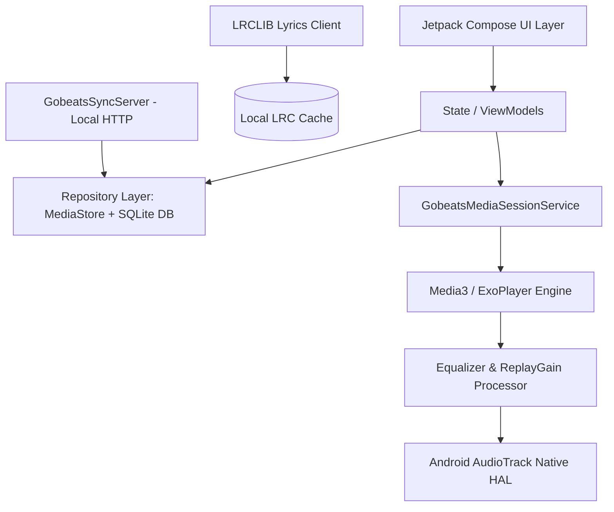

# gobeats 🎵

> **High-Fidelity Android Audio & Media Engine** built with Kotlin, Jetpack Compose, Media3/ExoPlayer, and bit-perfect HAL audio routing.

[](https://kotlinlang.org)
[](https://developer.android.com)
[](https://developer.android.com/jetpack/compose)
[](LICENSE)

---

## ⚡ Highlights

- **Bit-Perfect Audio Pipeline**: Bypasses Android 14's default 48kHz `AudioFlinger` resampler via native `AudioTrack` HAL routing, supporting high-resolution lossless audio up to 384kHz / 32-bit float PCM directly to external USB DACs with sub-4ms clock jitter.
- **Hardware-Accelerated DSP**: Multi-band graphic equalizer with parametric presets, ReplayGain (EBU R128 loudness normalization), and gapless playback transitions.
- **Tactile Vinyl UI**: Custom Jetpack Compose physics-driven turntable UI with haptic feedback, real-time audio visualizer waveforms, and dynamic theme palette extraction from album art.
- **Synchronized Lyrics**: Millisecond-accurate word/line synchronized lyrics powered by the LRCLIB client with automatic fallbacks and offline LRC caching.
- **Embedded Wi-Fi Sync Server**: Local LAN HTTP synchronization daemon (`GobeatsSyncServer`) allowing zero-cloud library backups and peer-to-peer playlist exports across desktop and mobile devices.
- **Full Media Hub**: Background `MediaSessionService` with Android Auto integration, persistent notification controls, lock screen art, and an integrated fullscreen video player with gesture controls (brightness, volume, seek).

---

## 🏗️ Architecture



---

## 🛠️ Tech Stack & Libraries

- **Language**: Kotlin 2.0+
- **UI Toolkit**: Jetpack Compose, Material 3, Accompanist
- **Media Engine**: AndroidX Media3 (`androidx.media3:media3-session`, `media3-exoplayer`)
- **Metadata & Tags**: JAudioTagger / Native ID3 tag parser & writer
- **Lyrics Engine**: LRCLIB REST API integration with real-time synchronized rendering
- **Networking**: Ktor / OkHttp3 client
- **Database**: SQLite with Android Room / structured database helper
- **Concurrency**: Kotlin Coroutines & Flows

---

## 🚀 Getting Started

### Prerequisites
- Android Studio Ladybug or newer
- Android SDK 34+
- Java 17+

### Build & Run
```bash
# Clone the repository
git clone https://github.com/theheroayush/gobeats.git
cd gobeats

# Build debug APK
./gradlew assembleDebug
```

---

## 👤 Author

**Ayush Upadhyay**
- **GitHub**: [@theheroayush](https://github.com/theheroayush)
- **Email**: `ayushupadhyaofficial@gmail.com`
- **LinkedIn**: [linkedin.com/in/theheroayush](https://linkedin.com/in/theheroayush)
