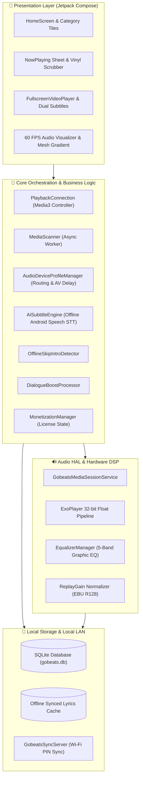

<div align="center">

# 🎵 gobeats

### The Audiophile & Offline-First Media Powerhouse for Android
**Bit-Perfect Media3 Audio • Offline AI Dual Subtitles • Hardware-Aware EQ Profiles • 60 FPS Visualizer • Local Wi-Fi PC Sync**

<p align="center">
  <a href="https://kotlinlang.org"></a>
  <a href="https://developer.android.com"></a>
  <a href="https://developer.android.com/jetpack/compose"></a>
  <a href="https://developer.android.com/guide/topics/media/media3"></a>
  <a href="https://theheroayush.github.io/gobeats/"></a>
</p>

---

[Key Features](#-what-makes-gobeats-different) • [Architecture](#-system-architecture) • [Audio & AI Engine](#-audio--ai-intelligence) • [Getting Started](#-getting-started) • [Privacy Policy](#-privacy--data-safety) • [Author](#-author)

</div>

---

## 🚀 What Makes gobeats Different?

Most media players today are bloated with ads, require cloud accounts, track listening habits, or struggle with high-resolution bit-perfect playback. 

**gobeats** is engineered from first principles for true sound enthusiasts, cinephiles, and privacy advocates who own their media. It leverages the raw compute power of your Android device to deliver audiophile acoustic processing, on-device AI transcription, and instant wireless library syncing—with **zero cloud dependence**.

```
┌────────────────────────────────────────────────────────────────────────┐
│  🎧 32-bit Float Bit-Perfect Audio    │  🎙️ Offline AI Dual Subtitles   │
│  🧠 Auto Device Hardware Profiles     │  🗣️ Acoustic Dialogue Boost    │
│  ⏩ 100% Offline Video Skip Intro     │  📴 Screen-Off Video Playback   │
│  🎨 Dynamic Album Mesh Gradients      │  ⚡ 60 FPS Realtime Visualizer │
│  📜 LRCLIB Synced Lyrics + Cache      │  💻 PIN-Based Local Wi-Fi Sync │
└────────────────────────────────────────────────────────────────────────┘
```

---

## 🌟 Flagship Capabilities (v3.2.0)

### 🎙️ 1. Offline AI Dual Subtitles (Speech-to-Text)
- **On-Device Regional Transcription**: Transcribes spoken dialogue completely offline using Android's native `SpeechRecognizer` engine (`isOnDeviceRecognitionAvailable`).
- **Indian Regional & Multilingual Focus**: Native support for **Hindi (`hi-IN`)**, **Tamil (`ta-IN`)**, **Telugu (`te-IN`)**, **Marathi (`mr-IN`)**, **Bengali (`bn-IN`)**, and **English (`en-IN`/`en-US`)**.
- **Simultaneous Dual Subtitle Stacking**: Renders primary dialogue (Bold Amber `#F59E0B`) stacked with secondary translated dialogue (Crisp Cyan `#E0F2FE`) with zero player latency.
- **Zero App Bloat**: Directly bridges to system voice language packs with one-tap download shortcuts.

### 🎧 2. Hardware Auto Device Profiles & Persistent AV Lip-Sync
- **Intelligent Routing Classifier**: Automatically identifies connected output hardware—**TWS Earbuds**, **Over-ear Headphones**, **Car Audio (Bluetooth/Aux)**, or **Built-in Phone Speaker**.
- **Auto EQ Preset Switching**: Instantly switches acoustic curves on peripheral connection (e.g., *Deep Bass Punch* for earbuds, *Warm Analog* for car acoustics, *Vocal Clarity* for built-in speakers).
- **Persistent Bluetooth AV Lip-Sync Delay**: Remembers per-device Bluetooth audio latency offsets (±500 ms) indexed by device MAC address or Bluetooth identifier. Dialogue and video stay permanently lip-synced whenever you reconnect.

### 🗣️ 3. Dialogue Boost (Formant Vocal Clarity Filter)
- Solves the classic problem of unintelligible movie voices buried under explosive sound effects and loud background music.
- Uses an acoustic formant band-pass filter (+4 dB / +7 dB boost across 300 Hz – 3.4 kHz) combined with low-end rumble attenuation (-3 dB / -6 dB at 60 Hz).
- Tweakable on the fly through the video player quick settings modal.

### ⏩ 4. 100% Offline Video Skip Intro
- Binge-watch local TV series and anime without manually scrubbing past openings.
- Automatically analyzes embedded chapter metadata and smart intro duration heuristics (0 to 85s) completely offline.
- Presents a fluid Jetpack Compose floating `[ ⏩ Skip Intro ]` action pill that vanishes smoothly after the sequence ends.

### 📴 5. Screen-Off Video Audio Continuity
- Listen to live video concerts, recorded lectures, podcasts, and documentaries with the screen locked or turned off.
- Media controls and track progress stay pinned to your lock screen notification without playback stutter or service crashes.

### 🎨 6. Dynamic Mesh Gradients & 60 FPS Audio Visualizer
- **Color Palette Extraction**: Extracts dominant, vibrant, and deep tonal anchors directly from album covers in real time.
- **Fluid Living Mesh**: Animates the Now Playing surface with interactive radial mesh transitions.
- **Hardware-Accelerated Visualizer**: 60 FPS real-time audio visualizer reacting dynamically to transient peaks, drum hits, and basslines.

### 💻 7. Seamless PIN-Based Local Wi-Fi PC Sync
- Built-in embedded HTTP daemon (`GobeatsSyncServer`).
- Pair your desktop browser with your phone over private local Wi-Fi using a clean 6-digit PIN.
- Transfer songs, full albums, and folders at full local gigabit Wi-Fi speeds without cables, third-party software, or cloud intermediaries.

### 📜 8. Millisecond-Accurate Synced Lyrics
- Automatic background fetching from the public LRCLIB database.
- Caches `.lrc` files locally in SQLite and internal storage for permanent offline availability.
- Interactive karaoke-style scrolling with line-tap scrub-to-timestamp navigation.

### 🧠 9. On-Device Smart Playlists
- Curates playlists dynamically based on private on-device telemetry:
  - **Most Played**: All-time high-rotation tracks.
  - **Heavy Rotation**: Top favorites played over the last 14 days.
  - **Recently Played**: Instant history playback.
  - **Forgotten Favorites**: Revives cherished tracks unplayed for over 30 days.
  - **Liked Songs**: Instant one-tap bookmarking.

### 💳 10. Future-Proof Licensing Architecture
- Backed by `MonetizationManager` (`com.example.gobeats.core.billing`).
- Fully unconstrained for v3.2 community users (`isProUnlocked = true`).
- Pre-wired with Google Play Billing v7+ scaffolding, giving the developer full autonomy to introduce optional PRO tiers, lifetime licenses, or subscriptions in subsequent updates without architectural refactoring.

---

## 🏗️ System Architecture



---

## 🛠️ Tech Stack & Dependencies

| Layer | Technologies |
| :--- | :--- |
| **Language** | Kotlin 2.3.20 (Strict Type Safety & Coroutines) |
| **UI Toolkit** | Jetpack Compose BOM 2026.03.01, Material 3, Accompanist |
| **Media Engine** | AndroidX Media3 1.4.1 (`media3-session`, `media3-exoplayer`, `media3-ui`) |
| **Audio Processing** | Android Native AudioFX (`Equalizer`, `LoudnessEnhancer`), Formant Filters |
| **Speech Recognition**| Android Native `SpeechRecognizer` (`isOnDeviceRecognitionAvailable`) |
| **Image & Palette** | Coil 2.7.0, AndroidX Palette API |
| **Database** | SQLite with optimized transactions & windowed cursor pagination |
| **Local Sync** | Embedded Lightweight NanoHTTPD / Ktor LAN server |
| **Testing** | JUnit 4, Mockito, Kotlinx Coroutines Test (345+ Automated Tests) |

---

## 🚀 Getting Started

### Prerequisites
- **Android Studio** Ladybug (2024.2+) or newer
- **Android SDK** API Level 34+
- **JDK** 17 or JDK 21

### Building the Project

```bash
# 1. Clone the repository
git clone https://github.com/theheroayush/gobeats.git
cd gobeats

# 2. Compile and run unit tests
./gradlew testDebugUnitTest

# 3. Build debug APK for testing
./gradlew assembleDebug

# 4. Build signed Google Play production App Bundle (.aab)
./gradlew bundleRelease
```

The production release bundle will be generated at:
```
app/build/outputs/bundle/release/app-release.aab
```

---

## 🔒 Privacy & Data Safety

gobeats complies strictly with Google Play 2026 Developer Program Policies, COPPA, and GDPR:

- **100% Offline-First**: All music scanning, video indexing, playlists, EQ curves, speech recognition, and AV delays reside solely on your device.
- **Zero Third-Party Analytics**: No Firebase Analytics, no Facebook SDK, and no tracking beacons.
- **Zero Third-Party Advertising**: No ad banners, interstitials, or rewarded video networks.
- **Live Privacy Policy**: Hosted publicly on GitHub Pages at:
  - **[https://theheroayush.github.io/gobeats/](https://theheroayush.github.io/gobeats/)**
  - **[https://theheroayush.github.io/gobeats/privacy-policy.html](https://theheroayush.github.io/gobeats/privacy-policy.html)**

---

## 📄 License & Commercial Notice

- Distributed for community use with full access unlocked.
- **Developer Commercial Rights**: The developer reserves complete autonomy to introduce optional monetization models, premium *gobeats PRO* features, lifetime licenses, or Google Play in-app billing in future releases.

---

## 👤 Author & Maintainer

<table align="center">
  <tr>
    <td align="center">
      <br />
      <sub><b>Ayush Upadhyay</b></sub><br />
      <a href="https://github.com/theheroayush">GitHub</a> • 
      <a href="https://linkedin.com/in/theheroayush">LinkedIn</a> • 
      <a href="mailto:ayushupadhyaofficial@gmail.com">Email</a>
    </td>
  </tr>
</table>

<div align="center">
  <sub>Engineered with precision for true music owners. ❤️ from India</sub>
</div>
